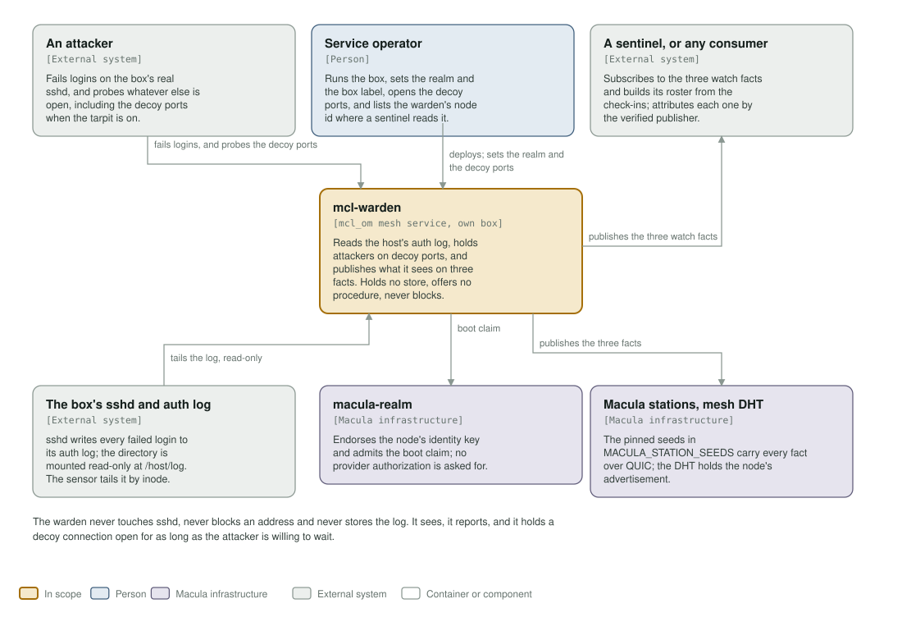
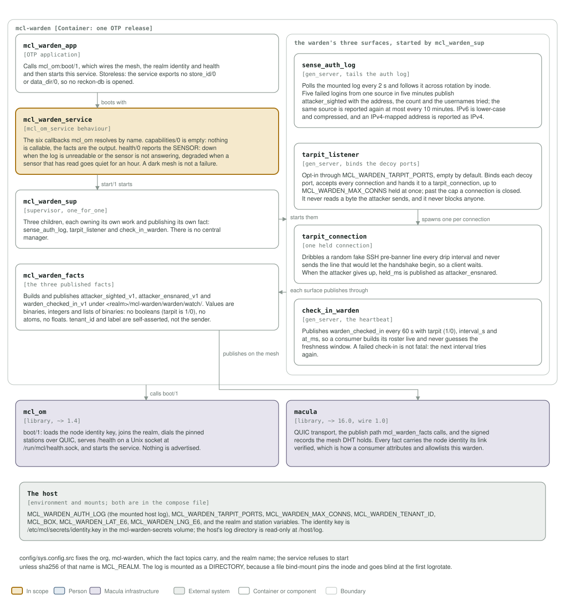

# mcl-warden architecture: C4 model

*This exists so a reader can see what mcl-warden talks to, and what it is made
of, without reading it.*

**Status: three published facts, no procedures, no store.** The service tails the
host's auth log, holds attackers on decoy ports when the tarpit is switched on,
and check-ins every 60 s. `capabilities/0` is empty and no reckon-db is opened:
the facts are the whole output.

## Level 1: system context

| Element | Kind | Role |
| --- | --- | --- |
| mcl-warden | In scope | Reads the host's auth log, holds attackers on decoy ports, and publishes what it sees on three facts. One OTP release in one container, an `mcl_om` mesh service on its own box. It never blocks, offers no procedure and holds no store |
| An attacker | External system | Fails logins on the box's real sshd, and probes whatever else is open, including the decoy ports when the tarpit is on |
| Service operator | Person | Runs the box, sets the realm and the box label, opens the decoy ports in the firewall, and lists the warden's node id where a sentinel reads it |
| A sentinel, or any consumer | External system | Subscribes to the three watch facts and builds its roster from the check-ins; attributes each fact by the verified publisher, never by the payload |
| The box's sshd and auth log | External system | sshd writes every failed login to its auth log; the directory is mounted read-only at `/host/log`, and the sensor follows it across rotation by inode |
| macula-realm | Macula infrastructure | Endorses the node's identity key and admits the boot claim. No provider authorization is asked for, because nothing is callable |
| Macula stations, mesh DHT | Macula infrastructure | The pinned seeds in `MACULA_STATION_SEEDS` carry every fact over QUIC; the DHT holds the node's advertisement |

The warden never touches sshd, never blocks an address and never stores the log.

## Level 2: containers and components

| Component | Technology | Responsibility |
| --- | --- | --- |
| `mcl_warden_app` | OTP application | Calls `mcl_om:boot/1`, which wires the mesh, the realm identity and health and then starts the service. Storeless: the service exports no `store_id/0` or `data_dir/0` |
| `mcl_warden_service` | the `mcl_om_service` behaviour | The six callbacks. `capabilities/0` is empty; `health/0` reports the sensor, `down` when the log is unreadable or the sensor is not answering, `degraded` when a sensor that has read goes quiet for an hour. A dark mesh is deliberately not a health failure |
| `mcl_warden_sup` | supervisor, `one_for_one` | Three children, each owning its own work and publishing its own fact. There is no central manager |
| `sense_auth_log` | `gen_server`, tails the auth log | Polls every 2 s and follows rotation by inode. Five failed logins from one source in five minutes publish `attacker_sighted`; the same source is reported again at most every 10 minutes |
| `tarpit_listener` | `gen_server`, binds the decoy ports | Opt-in through `MCL_WARDEN_TARPIT_PORTS`, empty by default. Accepts connections up to `MCL_WARDEN_MAX_CONNS` held, and never reads a byte the attacker sends |
| `tarpit_connection` | one held connection | Dribbles a random fake SSH pre-banner line and never sends the line that would start the handshake. When the attacker gives up, `held_ms` is published as `attacker_ensnared` |
| `check_in_warden` | `gen_server`, the heartbeat | Publishes `warden_checked_in` every 60 s with `tarpit` (1/0), `interval_s` and `at_ms`, so a consumer builds its roster live |
| `mcl_warden_facts` | the three published facts | Builds and publishes `attacker_sighted_v1`, `attacker_ensnared_v1` and `warden_checked_in_v1` under `<realm>/mcl-warden/warden/watch/`. Values are binaries, integers and lists of binaries: no booleans, no atoms, no floats |
| `mcl_om` | library, `~> 1.4` | `boot/1`: loads the node identity key, joins the realm, dials the pinned stations over QUIC, serves `/health` on a Unix socket at `/run/mcl/health.sock`, and starts the service. Nothing is advertised |
| macula | library, `~> 16.0`, wire 1.0 | QUIC transport, the publish path `mcl_warden_facts` calls, and the signed records the mesh DHT holds. Every fact carries the node identity its link verified |
| The host | environment and mounts | `MCL_WARDEN_AUTH_LOG`, `MCL_WARDEN_TARPIT_PORTS`, `MCL_WARDEN_MAX_CONNS`, `MCL_WARDEN_TENANT_ID`, `MCL_BOX`, the declared coordinates, and the realm and station variables. The identity key is a named volume at `/etc/mcl/secrets`; the host's log directory is read-only at `/host/log` |

`config/sys.config.src` fixes the org, `mcl-warden`, which the fact topics carry,
and the realm name; the service refuses to start unless
`sha256(MCL_REALM_NAME)` is `MCL_REALM`. The log is mounted as a directory, not a
file: a file bind-mount pins the inode, and the sensor goes blind while the
container still looks healthy.

`tenant_id` and `label` are self-asserted display attribution. Who sent a fact is
the node identity the publisher's link verified, which is the id the warden logs
at start and the one to put in a sentinel's warden list.

## Drawing them

`assets/c4-context.svg` and `assets/c4-components.svg` are generated by
`architecture/c4_diagrams.py` (`python3 architecture/c4_diagrams.py`), from the
code and never from this page: the callbacks in `mcl_warden_service.erl`, the
three surfaces under `mcl_warden_sup`, the facts in `mcl_warden_facts.erl`, the
dependencies in `rebar.config`, and the socket and volumes in the `Containerfile`
and `deploy/docker-compose.yml`. When one of those changes, the diagram changes
in the same commit.

Two rules for the files themselves, so they render everywhere they are read
(GitHub, an IDE, `rsvg-convert`): self-contained SVG, and literal colours in plain
classes plus a `prefers-color-scheme` dark block, never CSS custom properties,
which `rsvg-convert` renders black.

The check that keeps them here is the `c4-model` job in
`.github/workflows/build-push.yml`. It is red until both files exist and are
shown, and it stays red if either one goes missing.
